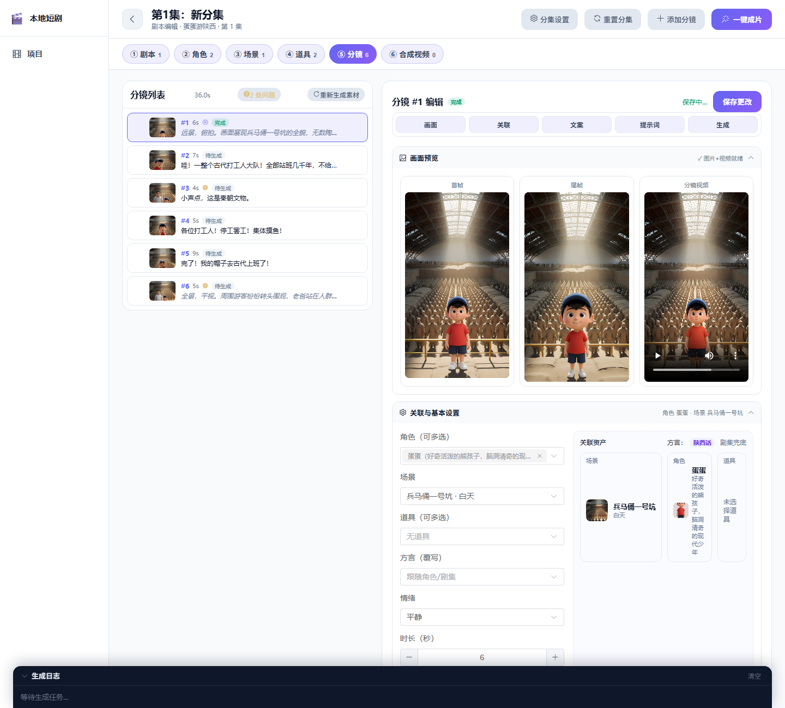
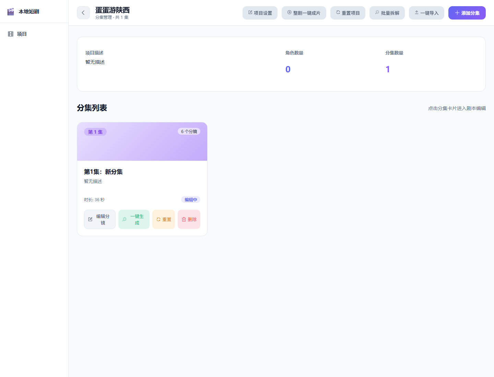
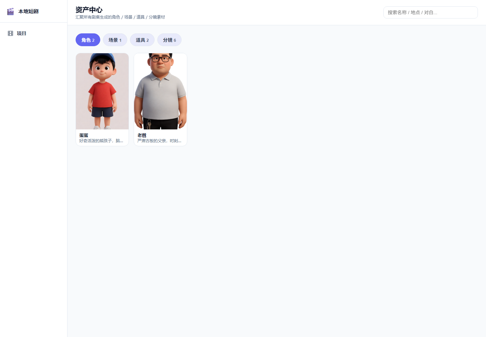
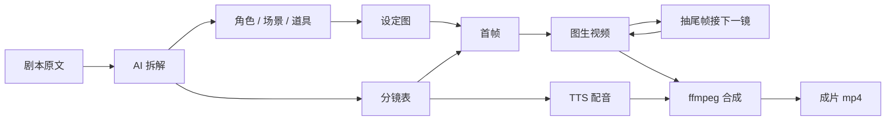

<div align="center">

# LocalMiniDrama · 本地 AI 漫剧工厂

**一段剧本进去，一条竖屏短剧出来。**

剧本拆解 → 角色/场景一致性 → 分镜首尾帧 → 图生视频 → 方言配音 → ffmpeg 成片，全流程跑在自己电脑上。

[](https://github.com/edrin09/LocalMiniDrama/stargazers)
[](#技术栈)
[](#技术栈)
[](#技术栈)
[](#参与共建)

`Local-first` · `数据不出本机` · `单机可跑`

[效果预览](#效果预览) · [核心特性](#核心特性) · [快速开始](#快速开始) · [常见问题](#常见问题)

</div>

---

## 这是什么

一个**跑在自己电脑上**的 AI 漫剧 / 短剧生产线。准备一段剧本原文和一个模型 Key，剩下的批处理它自己干：拆角色、立人设、画分镜、生成视频、配好音、拼成片。

它要解决的是批量生产里最烦的三件事：

1. **角色会变脸** —— 全剧共享角色 + 6 层视觉锚点 + 多参考图注入，跨集锁脸。
2. **画幅互相打架** —— 建项目时定死画幅，生图 / 生视频 / 合成共用同一份规格，不做后期硬裁。
3. **流水线靠人肉粘** —— 抽尾帧、接首帧、混配音、烧字幕，全部交给 ffmpeg。

## 效果预览



<p align="center"><sub><b>分镜工作台</b>：左侧分镜列表，右侧首帧 / 尾帧 / 视频三栏预览，角色、场景、道具、方言一次绑定</sub></p>





## 核心特性

| 能力 | 说明 |
| --- | --- |
| **整剧剧本拆解** | 原文交给文本模型，输出角色 / 场景 / 道具 / 分镜结构化 JSON；前端预览确认后落库，角色按姓名去重复用 |
| **角色一致性** | 6 层视觉锚点（脸型 / 发型 / 服饰 / 配色 / 标志物 / 气质）；分镜注入全部选中角色形象图（≤5 张）强锁脸 |
| **多角色 / 多道具** | 单镜可同时绑定多个角色与道具，提示词逐个写约束，不再一人一格 |
| **首尾帧接力** | 首帧来自生图，尾帧从上一段视频抽出，keyframe 模式生成，镜头之间不跳 |
| **方言配音** | 普通话 / 陕西话 / 东北话 / 粤语 / 成都话 / 上海话，剧集 → 角色 → 分镜三级覆写 |
| **自动合成** | 规整片段、纠正 90° 旋转、拼接、烧录字幕、混对白音轨，一条命令出 mp4 |
| **后台任务 + 实时日志** | 生成接口立即返回，任务后台跑，进度走 SSE，刷新不丢 |
| **一键清空重来** | 分集 / 整剧重置会物理清理素材，并按剧本原文自动重新拆解 |

## 工作流



## 快速开始

**环境要求**：Node.js ≥ 18；完整版 ffmpeg / ffprobe（需 `libx264`、`aac`、`subtitles` 滤镜）；一个可用的模型 Key（默认接 Agnes）。

```bash
git clone https://github.com/edrin09/LocalMiniDrama.git
cd LocalMiniDrama

cp .env.example .env          # 至少填 AGNES_API_KEY 与 FFMPEG_PATH

cd backend
npm install
DATABASE_URL="file:../../data/lmd.db" npx prisma db push   # 初始化表结构
npm run start:dev             # http://localhost:5679

cd ../frontend && npm install && npm run dev   # http://localhost:3013
```

Windows 用户可直接双击根目录 `run_dev.bat`，它会清端口、装依赖并同时拉起前后端。

**第一次使用**：新建项目（竖屏选 `9:16`）→ 进入分集，粘贴剧本到「剧本」页签 → AI 拆解 → 预览确认 → 生成角色/场景/道具图 → 一键生成。

> Prisma CLI 不会向上查找 `.env`，所以 `db push` 需显式带 `DATABASE_URL`；应用运行时由后端读取根目录 `.env`。

## 技术栈

- **前端**：Vue 3 + TypeScript + Vite + Element Plus + Pinia + Tailwind（关闭 preflight 以兼容 Element Plus）
- **后端**：NestJS 10 + Prisma 5 + SQLite
- **AI**：Agnes（文本 / 图像 / 视频）、火山引擎 TTS、Edge TTS，均为可替换 Provider
- **媒体**：ffmpeg / ffprobe（抽帧、转码、拼接、字幕、混音）
- **运行**：单机，无 Redis / Docker；并发控制走内存信号量

## 配置

配置集中在根目录 `.env`（不入库），完整字段见 [`.env.example`](./.env.example)。

| 变量 | 必填 | 说明 |
| --- | --- | --- |
| `AGNES_API_KEY` / `AGNES_BASE_URL` | 是 | 默认 AI 供应商凭据 |
| `FFMPEG_PATH` | 是 | 完整版 ffmpeg 路径；已在 PATH 中可留空 |
| `DATABASE_URL` | 否 | SQLite 路径，默认 `file:../../data/lmd.db` |
| `PORT` / `UPLOAD_DIR` | 否 | 后端端口与素材目录 |
| `VOLC_TTS_APP_ID` / `VOLC_TTS_TOKEN` | 否 | 火山 TTS；不填回退 Edge TTS |
| `PUBLIC_BASE_URL` | 否 | 仅当远端素材 URL 失效、需暴露本地素材时使用 |

界面「全局配置」可覆盖 AI 与调度参数，快照落在 `data/ai-config.json`，`.env` 只作启动默认。

## 目录结构

```
backend/
  prisma/schema.prisma        # Drama / Episode / Character / Scene / Prop / Storyboard
  src/ai/                     # Provider 抽象、Agnes、TTS、ffmpeg、限流、存储
  src/generate/               # 流水线调度、SSE 日志、剧本拆解、合成
frontend/src/views/           # 项目 / 分集 / 剧本编辑 / 成片 / 资产中心
data/                         # SQLite + uploads（不入库）
run_dev.bat                   # Windows 一键启动
```

## 常见问题

**生成失败 / 没反应？** 先看 `backend/crash.log` 与前端日志面板；视频接口偶发 429/5xx 会退避重试，401/402/403 才熔断。

**成片有黑边或变形？** 画幅是生成参数而非裁切参数，改了项目规格必须重新生成素材。

**画面被旋转 90°？** 合成阶段默认自动检测并 `transpose` 纠正（`mergeCfg.auto_correct_rotation`），但只能恢复自然朝向，无法把横屏内容压回竖屏构图。

**配音是机器音？** 未配火山 TTS 时降级保留原声；补齐凭据后在分集里重新「生成配音」。

## 路线图

- [x] 剧本拆解 / 角色一致性 / 多角色多道具 / 首尾帧接力
- [x] TTS 配音与自动合成
- [ ] 批量多集并行调度
- [ ] 背景音乐与音效轨
- [ ] 更多视频 Provider（可灵 / 即梦 / Runway）

## 参与共建

欢迎 Issue 与 PR：新 Provider、提示词模板、踩坑记录都有价值。如果它帮你省下了几个通宵，点个 **Star** ⭐ 是最直接的支持。

> 本项目仅供学习与技术研究使用，生成内容请遵守所在地区法律法规与平台规则。仓库不含任何 API Key，`.env`、`data/`、构建产物均已加入 `.gitignore`。

---

[GitHub](https://github.com/edrin09/LocalMiniDrama) · [Gitee](https://gitee.com/edrin/LocalMiniDrama) · [问题反馈](https://github.com/edrin09/LocalMiniDrama/issues)
