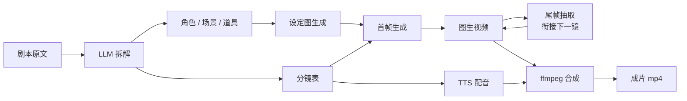

<div align="center">

# LocalMiniDrama · AI 漫剧工厂

**把一段小说丢进去，出来一条竖屏短剧。**

剧本拆解 → 角色/场景/道具设定 → 分镜首帧 → 图生视频 → TTS 配音 → ffmpeg 成片，全流程一键跑通。

[](#技术栈)
[](#技术栈)
[](#技术栈)
[](#技术栈)
[](#技术栈)

`Local-first` · `单机可跑` · `数据不出本机`

</div>

---

## 这是什么

一个**跑在自己电脑上**的 AI 漫剧 / 短剧生产线。你只需要准备一段剧本原文和一个模型 Key，剩下的批次活它自己干：拆角色、立人设、画分镜、生成视频、配好音、拼成片。

它不是为了做一个「AI 视频玩具」，而是为了解决批量生产里最烦的三件事：

1. **角色会变脸** —— 第 3 集和第 9 集看起来像两个人。这里用全剧共享角色 + 6 层视觉锚点 + 多参考图注入来锁脸。
2. **素材画幅打架** —— 生图 9:16、成片 16:9，最后只能压成窄条。这里把画幅定在项目创建时，生图 / 生视频 / 合成共用同一份规格。
3. **流水线靠人肉粘** —— 抽尾帧、接首帧、混配音、去黑边，全在 ffmpeg 里自动做完。

## 工作流



## 界面预览


<p align="center"><sub>分镜编辑：左侧分镜列表，右侧首帧 / 尾帧 / 视频三栏预览，角色、场景、道具、方言一次绑定</sub></p>


## 核心特性

| 能力 | 说明 |
| --- | --- |
| **整剧剧本拆解** | 原文整段交给文本模型，输出角色 / 场景 / 道具 / 分镜的结构化 JSON。前端先预览确认再落库，角色按姓名全剧去重复用并补全缺失字段。 |
| **角色一致性** | 6 层视觉锚点（脸型 / 发型 / 服饰 / 配色 / 标志物 / 气质）+ 分镜注入所有选中角色的形象图（单镜最多 5 张）作参考，跨集锁脸。 |
| **多角色 / 多道具** | 一个分镜可同时绑定多个角色与道具，提示词逐个写约束，不再一人一格。 |
| **画幅单一真相源** | 建项目时定 `9:16 / 16:9`、帧率、清晰度，生图、生视频、合成三步共用，避免后期硬裁。 |
| **首尾帧接力** | 视频走 keyframe 模式：首帧来自生图，尾帧从上一段视频抽出，保证镜头之间不跳。 |
| **双 TTS 引擎** | 火山引擎 TTS（真实中文配音）或 Edge TTS，按「剧集 → 角色 → 分镜」三级方言/音色分配，自动混入成片。 |
| **自动合成** | ffmpeg 规整片段、纠正 90° 旋转、拼接、烧录旁白字幕、混对白音轨，一条命令出 mp4。 |
| **后台任务 + 实时日志** | 生成类接口立即返回，任务后台跑，进度通过 SSE 推到前端，刷新页面不丢。 |
| **一键清空重来** | 分集 / 整剧「重置」会物理清理素材、重置状态，并按剧本原文自动重新拆解。 |

## 技术栈

- **前端**：Vue 3 + TypeScript + Vite + Element Plus + Pinia + Tailwind（原子类，关闭 preflight 以兼容 Element Plus）
- **后端**：NestJS 10 + Prisma 5 + SQLite
- **AI**：Agnes（文本 / 图像 / 视频）、火山引擎 TTS、Edge TTS —— 均为可替换的 Provider
- **媒体**：ffmpeg / ffprobe（抽帧、转码、拼接、字幕、混音）
- **部署**：单机，无 Redis / 无 Docker 依赖；并发控制走内存信号量

## 快速开始

### 环境要求

- Node.js ≥ 18
- **完整版 ffmpeg / ffprobe**（需自带 `libx264`、`aac`、`subtitles` 滤镜；系统自带的精简版常常缺滤镜）
- 一个可用的 AI Key（默认接 Agnes）

### 安装

```bash
git clone https://github.com/edrin09/LocalMiniDrama.git
cd LocalMiniDrama

# 1. 配置环境变量
cp .env.example .env
# 编辑 .env：至少填 AGNES_API_KEY 和 FFMPEG_PATH

# 2. 后端
cd backend
npm install
DATABASE_URL="file:../../data/lmd.db" npx prisma db push   # 初始化 SQLite 表结构
npm run start:dev              # http://localhost:5679

# 3. 前端（新终端）
cd frontend
npm install
npm run dev                    # http://localhost:3013
```

Windows 用户也可以直接双击根目录的 `run_dev.bat`，它会清端口、清构建产物并同时拉起前后端。

> 说明：应用运行时由后端读取**根目录** `.env`；但 Prisma CLI 不会向上层目录查找，所以上面单独给 `prisma db push` 传了 `DATABASE_URL`（也可在 `backend/.env` 里写同样一行，之后省略该前缀）。

### 第一次使用

1. 新建项目，选好画幅（竖屏短剧选 `9:16`）。
2. 进入分集，把剧本原文粘进「剧本」页签。
3. 点「AI 拆解」→ 预览确认 → 落库。
4. 生成角色 / 场景 / 道具设定图，按需改提示词重生成。
5. 「一键生成」跑分镜首帧 → 视频 → 配音，最后合成成片。

## 配置

所有配置集中在根目录 `.env`（不入库），完整字段见 [`.env.example`](./.env.example)。

| 变量 | 必填 | 说明 |
| --- | --- | --- |
| `DATABASE_URL` | 是 | SQLite 路径，默认 `file:../../data/lmd.db` |
| `PORT` | 否 | 后端端口，默认 `5679` |
| `UPLOAD_DIR` | 否 | 素材目录，默认 `../data/uploads` |
| `FFMPEG_PATH` | 是 | 完整版 ffmpeg 可执行文件路径 |
| `AGNES_API_KEY` / `AGNES_BASE_URL` | 是 | 默认 AI 供应商凭据 |
| `VOLC_TTS_APP_ID` / `VOLC_TTS_TOKEN` | 否 | 火山 TTS，不填则走模拟降级 / Edge TTS |
| `PUBLIC_BASE_URL` | 否 | 仅当远端素材 URL 失效、需暴露本地素材时使用 |

> 运行时还可以在「设置」里覆盖 AI 与调度参数，快照落在 `data/ai-config.json`、`data/scheduler-config.json`；`.env` 里的值只作为启动默认。

## 目录结构

```
.
├── backend/
│   ├── prisma/schema.prisma        # Drama / Episode / Character / Scene / Prop / Storyboard
│   └── src/
│       ├── ai/                     # Provider 抽象、Agnes、TTS、ffmpeg、限流、存储
│       ├── drama/  episode/  script/   # 项目、分集、角色/场景/道具/分镜 CRUD
│       ├── generate/               # 流水线调度、SSE 日志、剧本拆解、合成
│       └── app-config/             # AI / 调度配置的读写
├── frontend/src/views/             # 项目列表、分集管理、剧本编辑、成片页、资产中心
├── data/                           # SQLite + uploads/{dramaId}/{episodeId}（不入库）
└── run_dev.bat                     # Windows 一键启动
```

## 常见问题

**生成失败 / 没有反应？**
先看 `backend/crash.log` 和前端日志面板。视频接口偶发 429/5xx 会退避重试，只有 401/402/403 才熔断。

**成片有黑边或变形？**
检查项目画幅与素材画幅是否一致。画幅是**生成参数**，不是后期裁切参数——改了项目规格必须重新生成素材。

**画面被旋转了 90°？**
AI 视频偶发把横屏构图塞进竖屏容器。合成阶段默认开启自动检测与 `transpose` 纠正（`mergeCfg.auto_correct_rotation`），但只能恢复自然朝向，无法把横屏内容压回竖屏构图。

**配音是机器音 / 没有配音？**
没配火山 TTS 时会降级保留 AI 视频原声。填好 `VOLC_TTS_APP_ID` + `VOLC_TTS_TOKEN` 后在分集里重新「生成配音」。

## 路线图

- [x] 剧本拆解 / 角色一致性 / 多角色多道具 / 首尾帧接力
- [x] TTS 配音与自动合成
- [ ] 批量多集并行调度
- [ ] 背景音乐与音效轨
- [ ] 更多视频 Provider（可灵 / 即梦 / Runway）

## 说明

- 本项目仅供学习与技术研究使用。生成内容请遵守所在地区法律法规与平台规则，不得用于侵权、虚假信息或违规用途。
- 仓库不含任何 API Key。`.env`、`data/`、构建产物均已加入 `.gitignore`。

---

**如果这个项目对你有用，点个 Star 是最好的支持。**

[GitHub](https://github.com/edrin09/LocalMiniDrama) · [Gitee](https://gitee.com/edrin/LocalMiniDrama) · [问题反馈](https://github.com/edrin09/LocalMiniDrama/issues)
